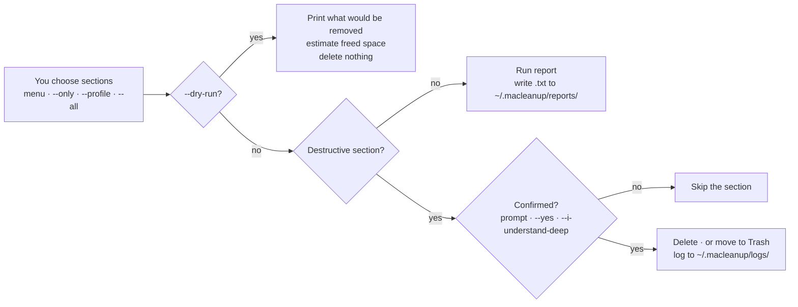

# Introduction

**macleanup is a command-line macOS cleanup and maintenance tool that deletes
files from your machine to reclaim disk space.** It ships as one bash script
with twenty-eight numbered sections — developer caches, browser caches, system
and user logs, temp files, orphaned application data, stale build artefacts,
large dormant files, unused apps and several read-only reports. You pick which
sections run; each destructive one asks by default before it acts, and
`--dry-run` shows the planned cleanup without deleting files. It still writes
its normal run log unless you choose a different log location.

It is MIT-licensed, makes no network calls beyond an opt-in version check, and
requires nothing but macOS 11+ and bash 3.2+.

The [macleanup desktop app](/desktop-app/overview), released with 5.2.0, runs
the same script in a window. The command line works with or
without it.

:::danger[This tool deletes files]
Deletion is the point of the tool, and most of it is **not reversible**.
Many caches can regenerate, but logs may be needed for diagnosis. A deleted
`node_modules`, a purged Xcode archive, or an emptied Trash may require a backup
to recover.

Before your first real run: read [What gets deleted](/before-you-run/what-gets-deleted),
then preview with [`--dry-run`](/before-you-run/dry-run). Check the listed paths
and recovery method before you confirm a destructive section.
:::

## The thirty-second version

```bash
# 1. See what a safe-batch cleanup would remove — deletes nothing.
npx macleanup --dry-run --all

# 2. List every section so you know what the numbers mean.
npx macleanup --list

# 3. Run interactively and choose sections one at a time.
npx macleanup
```

No separate install step is required — `npx` fetches and runs the package. npm
may retain its download cache. Your logs and reports are written to
`~/.macleanup/` and survive every invocation.

## What it is good at

| Job | How macleanup handles it |
|---|---|
| Reclaiming developer disk space | Sections 1–4 cover Xcode, Gradle/Android, package managers and Docker; section 23 sweeps stale `node_modules` and friends |
| Emptying caches without losing settings | Browser caches are cleared per profile; bookmarks, history and passwords are not touched |
| Uninstalling an app completely | Section 21 moves the app to the Trash and removes its known companion data, including Group Containers |
| Auditing before deciding | Sections 0, 15, 18 and 26 only produce reports; section 25 reports stale launch items in batch mode unless both removal flags are set |
| Scripted, repeatable cleanups | `--only`, `--profile`, `--yes`, `--quiet` and `--json` make it cron- and CI-friendly |

## What it is not

Honesty matters more here than in most tools, because the failure mode is lost
data:

- **It is not a backup tool, and it does not create restore points.** Keep a
  verified external backup before a large run. A local Time Machine snapshot
  can help with some recovery, but it is not a substitute for a separate backup.
- **It is not undoable.** There is no `macleanup --undo`. Items moved by
  sections 12, 21 and 24 may be restored from Trash until it is emptied;
  directly deleted items need your own backup.
- **It is not a Linux tool.** It reads macOS-specific paths and calls
  `tmutil`, `xcrun`, `dscacheutil`, `launchctl` and `osascript`. There is no
  Linux port and it refuses to start on a non-Darwin platform.
- **It does not know your project layout.** Section 23 deletes build
  directories that look stale by timestamp. If a directory matters to you and
  you have not opened it in months, protect it with `--exclude-path`.
- **It cannot guarantee an app uninstall is complete.** It removes the known
  companion locations for an app; a developer who scattered files elsewhere is
  outside its knowledge.

## How the pieces fit together



## Where to go next

| You want to | Read |
|---|---|
| Know exactly what disappears | [What gets deleted](/before-you-run/what-gets-deleted) |
| Preview a run safely | [Preview with `--dry-run`](/before-you-run/dry-run) |
| Understand the guarantees | [Safety model](/before-you-run/safety-model) |
| Install it | [Installation](/getting-started/installation) |
| Walk through a first session | [Your first run](/getting-started/first-run) |
| Look up a flag | [CLI reference](/reference/cli) |
| Look up a section number | [The 28 sections](/reference/sections) |
| Copy a working command | [Recipes](/recipes) |
| Use the desktop app | [Desktop app](/desktop-app/overview) |
| Fix something that went wrong | [Troubleshooting](/troubleshooting) · [Recovery](/recovery) |

## Project facts

| | |
|---|---|
| Package | [`macleanup` on npm](https://www.npmjs.com/package/macleanup) — current documented version **5.2.0** |
| Command installed | `macleanup` |
| Source | [github.com/aoneahsan/macleanup](https://github.com/aoneahsan/macleanup) |
| Requirements | macOS 11+, bash 3.2+; Node only if you use `npx` or a global npm install |
| Licence | MIT — use, modify, redistribute, sell; no warranty, no liability |
| Author | [Ahsan Mahmood](/about-the-author) |
