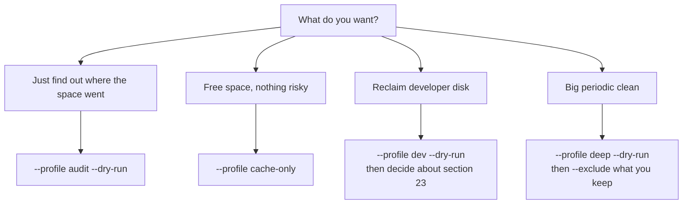

# Profiles

**A profile is a named bundle of section numbers**, so a common workflow is one
flag instead of a list. `--profile NAME` selects one; `--exclude` subtracts
from it.

```bash
mac-cleanup --profile dev --dry-run
mac-cleanup --profile deep --exclude 14,17 --yes
```

## The five profiles

| Profile | Sections | Deletes permanently? | When to use |
|---|---|:-:|---|
| `audit` | `0, 12, 18, 21, 25, 26` | optional Trash moves and launch-item removal if confirmed | Find out where the disk went, before deciding anything |
| `dev` | `1, 2, 3, 4, 23` | ⚠️ yes — section 23 | Reclaim developer-tool caches and stale `node_modules` |
| `minimal` | `5, 7, 8, 9` | no | A quick weekly sweep that leaves Trash alone |
| `cache-only` | `3, 5, 6, 7, 9, 19` | direct log and cache removal | Cache and log layers |
| `deep` | `0, 1, 2, 3, 4, 5, 6, 7, 8, 9, 17, 19, 23, 26` | ⚠️ yes — sections 17 and 23 | A big monthly cleanup |

:::warning["Profile" does not mean "safe"]
Two of the five include a section that deletes permanently. Run any profile
with `--dry-run` before you run it with `--yes`.
:::

## `audit` — look, don't touch

```bash
mac-cleanup --profile audit
```

Sections `0, 12, 18, 21, 25, 26`: system health, orphaned app data, large
files, idle apps, the LaunchAgents audit and a disk-usage report. Writes dated
`.txt` files to `~/.mac-cleanup/reports/`.

Sections 0, 18 and 26 are pure reports. Sections **12 and 21 can move data to
the Trash** when confirmed. Section 25 can permanently remove selected launch
items. In batch mode it stays report-only unless both `--yes` and
`--i-understand-deep` are supplied; that combination removes every candidate.
Section 21 also needs both flags to run unattended.

Add `--dry-run` if you want a guaranteed look-only pass:

```bash
mac-cleanup --profile audit --dry-run
```

This is the best first command after installing.

## `dev` — reclaim developer space

```bash
mac-cleanup --profile dev --dry-run
```

Sections `1, 2, 3, 4, 23`: Xcode, Gradle/Android, package managers, Docker, and
stale build artefacts.

The first three cover developer caches. Section 4 also offers interactive
Docker volume pruning, which can permanently delete database data; batch mode
skips that offer. **Section 23 permanently deletes build
directories** — `node_modules`, `vendor`, `dist`, `.next`, `target`, `Pods` —
that have been untouched for `--stale-build-days` days. Combine with a tighter
threshold and protected paths:

```bash
mac-cleanup --profile dev --stale-build-days 120 \
  --exclude-path "$HOME/Code/active-client" --dry-run
```

Or drop section 23 entirely for a developer maintenance pass without build
directory deletion. In interactive mode, section 4 still offers an optional
Docker volume prune; decline it if the volumes matter:

```bash
mac-cleanup --profile dev --exclude 23 --yes
```

## `minimal` — the weekly sweep

```bash
mac-cleanup --profile minimal --dry-run
```

Sections `5, 7, 8, 9`: user caches, logs, old top-level temp files and update
caches. This profile does not empty Trash. Section 10 requires an explicit
selection and both `--yes` and `--i-understand-deep` when run unattended.

## `cache-only` — every cache layer

```bash
mac-cleanup --profile cache-only --dry-run
```

Sections `3, 5, 6, 7, 9, 19`: package managers, user caches, system caches
(sudo), logs, update caches and browser caches.

This profile focuses on caches and logs, but deleted logs and saved window state
may be unique. Section 6
needs sudo and is deep-gated, so unattended runs need `--i-understand-deep`, or
skip it:

```bash
mac-cleanup --profile cache-only --no-sudo --yes
```

Expect slower first page loads afterwards while browser caches rebuild.

## `deep` — the monthly clean

```bash
mac-cleanup --profile deep --dry-run
```

Sections `0, 1, 2, 3, 4, 5, 6, 7, 8, 9, 17, 19, 23, 26` — the broadest bundle.

Two members delete permanently:

- **Section 17** — Xcode archives, which hold the dSYMs for symbolicating
  crashes from already-shipped builds.
- **Section 23** — stale build directories.

A common shape is the deep sweep minus the two you want to keep control of:

```bash
mac-cleanup --profile deep --exclude 17,23 --yes
```

Note that `deep` does **not** include section 14 (`/private/var/folders`), even
though the name suggests it might. Section 14 is only reachable from the menu
or by `--only`, and needs a typed `yes`.

## Combining profiles with other flags

```bash
# Subtract sections
mac-cleanup --profile deep --exclude 14,17

# Tune a threshold for the sections in the profile
mac-cleanup --profile dev --cache-age-days 60 --yes

# Unattended, including deep-gated members
mac-cleanup --profile deep --yes --i-understand-deep

# Skip everything that needs sudo
mac-cleanup --profile cache-only --no-sudo --yes
```

`--exclude` applies on top of the profile. There is no way to *add* a section
to a profile — use `--only` with an explicit list instead.

## Choosing a profile



## Next

- [The 28 sections](/reference/sections) — what each number in a profile does.
- [CLI reference](/reference/cli) — `--profile`, `--exclude` and the thresholds.
- [Recipes](/recipes) — goal-shaped commands, profiles included.
